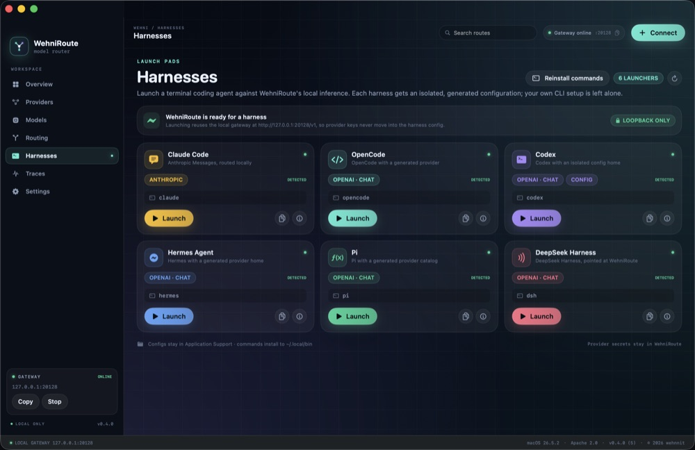
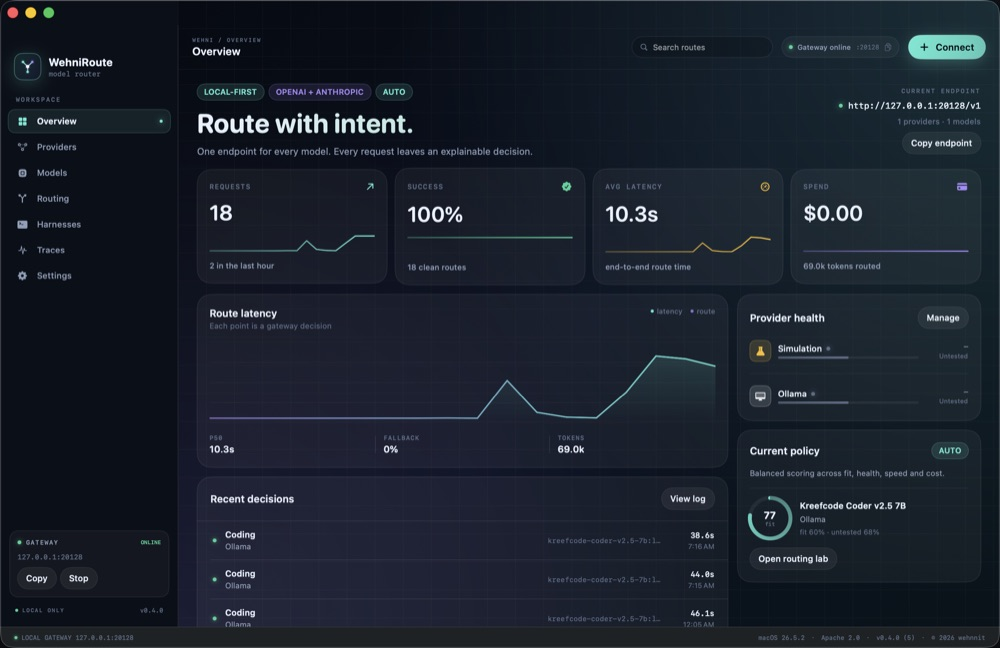
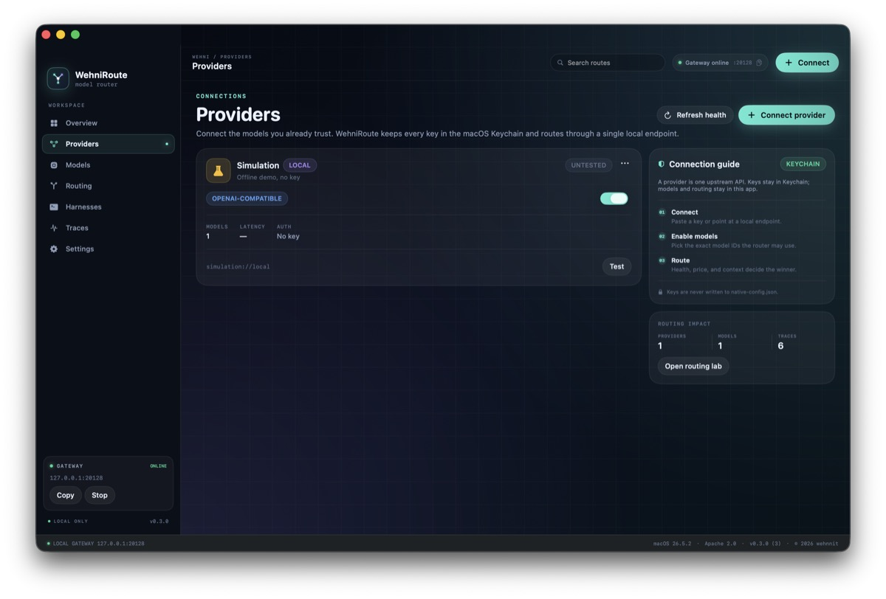
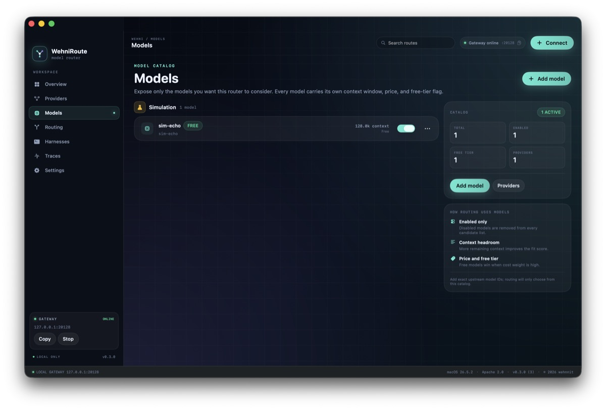
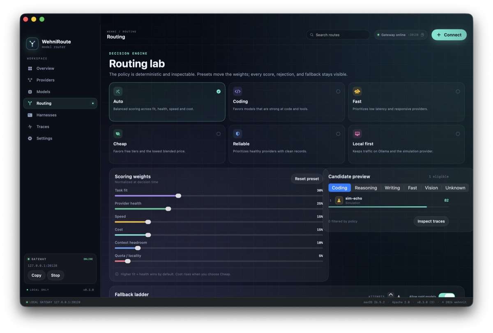
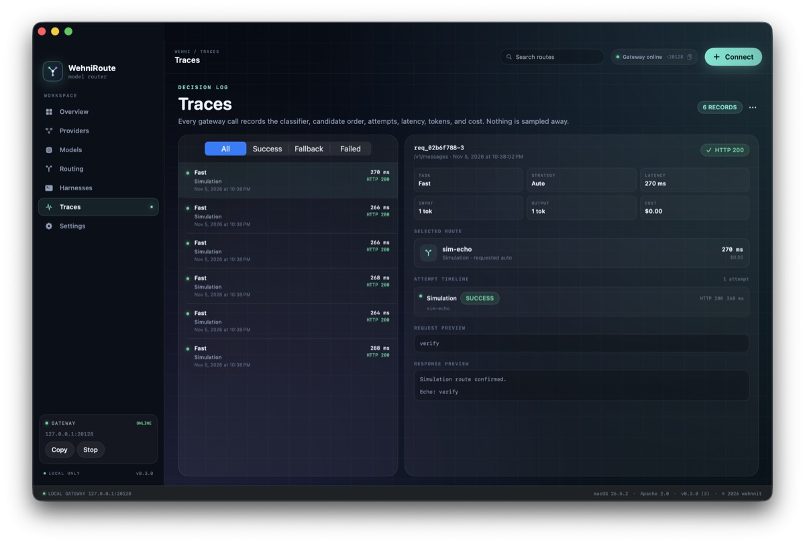
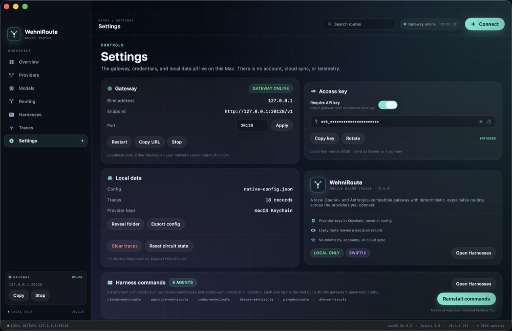

<p align="center">
  
</p>

<h1 align="center">WehniRoute</h1>

<p align="center">
  One local endpoint. Every provider you trust. An explainable decision for every request.
</p>

<p align="center">
  
  
  
</p>

WehniRoute is a native macOS control plane for model routing: a SwiftUI app backed by a loopback OpenAI- and Anthropic-compatible gateway. It scores every configured model on task fit, provider health, speed, cost, context headroom, and locality, then falls back through the ranked ladder while recording every attempt.

**Version 0.6.0** adds 18 local inference engines (Jan, GPT4All, KoboldCpp, Text Generation WebUI, TabbyAPI, llama.cpp server, llamafile, LocalAI, Hugging Face TGI, MLX-LM, vLLM, llama-cpp-python, SGLang, mistral.rs, Xinference, Docker Model Runner, AMD Lemonade, and LiteLLM Proxy) as first-class providers with presets, $0 pricing, and one-click catalog import from **Providers → Scan**. Shared loopback ports are disambiguated by engine-specific probes rather than guessed, scanning probes every port concurrently, and llama.cpp is found on both 8080 and its new 9931 default. Routing gains a **Failover scope** option — **Global** (score-ordered) or **Provider first**, which exhausts a provider's own models by score before moving on — plus per-model health, so one misbehaving model cools down alone instead of taking its whole provider out of rotation. Every harness still sees the single **WehniRoute Auto** model (`/v1/models` lists only `auto`; response bodies report `model: auto`) while the trace log keeps the real provider and model that answered.



---

## Install without a paid Apple Developer ID

The release is **ad-hoc signed**, not notarized with a paid Apple Developer ID. The app is otherwise complete and auto-updating. On the first launch of a downloaded copy, macOS will block it. The tested macOS 26.5.2 flow is:

1. Download `WehniRoute-0.6.0.zip` and `WehniRoute-0.6.0.zip.sha256` from [Releases](https://github.com/wehnnit/WehniRouteMac/releases/latest).
2. Verify the download in Terminal:

   ```bash
   cd ~/Downloads
   shasum -a 256 -c WehniRoute-0.6.0.zip.sha256
   ```

   The `.sha256` asset is the authoritative digest for the matching zip.

3. Unzip it, create `~/Applications` if needed, and move **WehniRoute.app** to `~/Applications/WehniRoute.app`. `/Applications` also works if your account can write there.
4. Open the app once. macOS shows **“WehniRoute” Not Opened**; click **Done** (not **Move to Trash**).
5. Open **System Settings → Privacy & Security** and scroll to **Security**.
6. Click **Open Anyway** next to the blocked WehniRoute message.
7. Authenticate with an administrator's Touch ID or administrator password, then confirm **Open**.

This is a one-time Gatekeeper confirmation. The administrator authentication is mandatory for an ad-hoc-signed app; a standard user without administrator authorization cannot complete this step. Auto-updates replace the app in place and clear quarantine on the new bundle. When the current folder is read-only — for example under App Translocation — the updater installs to `~/Applications/WehniRoute.app` instead and relaunches from there.

> A Developer ID certificate is not required to build, ad-hoc sign, zip, auto-update, or use this app. It is only required for a warning-free first-open experience.

---

## First-run setup

If `~/Library/Application Support/WehniRoute` is missing, WehniRoute shows a setup wizard instead of silently creating defaults. The wizard:

- Configures the loopback gateway and optional local API-key enforcement.
- Seeds the offline **Simulation** provider (`sim-echo`) so the gateway is usable immediately.
- Creates the latest schema version of:
  - `native-config.json`
  - `native-traces.json`
  - `gateway.key` with mode `0600`
- Starts the gateway after setup.

Existing installations migrate automatically. Open **Harnesses** from the sidebar after setup; it detects installed CLI agents and generates a launch script for each one.

---

## Harnesses

The **Harnesses** section turns WehniRoute into the inference plane for terminal coding agents. Each card shows whether the CLI is installed, what protocol it speaks, and a one-click **Launch** button that opens a real Terminal session. Use **Install commands** to add short `claude-wehniroute`, `codex-wehniroute`, and sibling commands to `~/.local/bin`, then run them from any Terminal window. The same installer is available in **Settings → Harness commands**.

All launch scripts read the local gateway key at launch. Provider API keys stay in the macOS Keychain and never enter a harness config, a shell history entry, or the trace log.

| Harness | Command | Wire format | Generated configuration |
| --- | --- | --- | --- |
| Claude Code | `claude` | Anthropic Messages | `ANTHROPIC_BASE_URL`, `ANTHROPIC_AUTH_TOKEN`, model aliases |
| OpenCode | `opencode` | OpenAI Chat Completions | Dedicated workspace with a `wehni` provider (upstream 2.0.26 runtime limitation) |
| Codex | `codex` | OpenAI Chat Completions | Isolated `CODEX_HOME` with a `wehni` provider |
| Hermes Agent | `hermes` | OpenAI-compatible custom endpoint | Isolated `HERMES_HOME` with a `wehni` provider |
| Pi | `pi` | OpenAI Chat Completions | Isolated `PI_CODING_AGENT_DIR` with `models.json` |
| DeepSeek Harness | `dsh` | DeepSeek / OpenAI-compatible | `DEEPSEEK_BASE_URL`, `DEEPSEEK_API_KEY`, DSH web profile |

### Install the CLIs

```bash
# Claude Code
npm install -g @anthropic-ai/claude-code

# OpenCode
curl -fsSL https://opencode.ai/install | bash

# Codex
npm install -g @openai/codex

# Hermes Agent
curl -fsSL https://hermes-agent.nousresearch.com/install.sh | bash

# Pi
curl -fsSL https://pi.dev/install.sh | sh

# DeepSeek Harness
npm install -g @deepseek-ai/dsh
```

### Connect TalkNova as a provider

To also make TalkNova's own models available to other harnesses, copy your personal `tn-live-…` key from TalkNova's **Settings → API access**, then use **Connect provider → TalkNova**. WehniRoute reaches TalkNova's OpenAI-compatible catalog at `https://talknova.site/v1` and its models join the routing ladder for every harness.

Then click the refresh button in Harnesses. Detection checks each CLI's well-known install locations (`~/.local/bin`, `~/.opencode/bin`, `~/.hermes/node/bin`, Homebrew and npm-global prefixes, and more) before falling back to a shell lookup, so harnesses installed outside the login-shell `PATH` are still found. **Launch** is enabled when the executable is found.

### Terminal commands

**Install commands** writes one wrapper per detected CLI to `~/.local/bin`:

```bash
# Add once to ~/.zshrc, then open a new Terminal:
echo 'export PATH="$HOME/.local/bin:$PATH"' >> ~/.zshrc

claude-wehniroute      # Claude Code through WehniRoute
opencode-wehniroute    # OpenCode through WehniRoute
codex-wehniroute       # Codex through WehniRoute
hermes-wehniroute      # Hermes Agent through WehniRoute
pi-wehniroute          # Pi through WehniRoute
dsh-wehniroute         # DeepSeek Harness through WehniRoute
```

Each wrapper regenerates the isolated harness configuration, reads the local gateway key, and `exec`s the real CLI with any arguments you append.

### What gets generated

The app writes only under `~/Library/Application Support/WehniRoute/harnesses/`:

- `claude-code.command` — Anthropic base URL and local gateway token.
- `opencode-workspace/opencode.json` — OpenCode's documented custom-provider shape using `@ai-sdk/openai-compatible`. OpenCode starts in this dedicated workspace so its project-level config discovery finds the generated provider. OpenCode 2.0.26 currently drops custom providers in its server runtime; the generated config is ready for a build that honors it.
- `codex-home/config.toml` — an isolated Codex provider with `wire_api = "chat"`. Codex is intentionally not exercised by this project's local QA.
- `hermes-home/config.yaml` — an isolated `HERMES_HOME` with a `wehni` provider; Hermes starts with `--provider wehni -m auto`.
- `~/.local/bin/<agent>-wehniroute` — optional terminal wrappers installed by **Install commands**.
- `pi-agent/models.json` — an isolated Pi provider catalog with model `auto`.
- `deepseek.command` — exports the DeepSeek base URL/key and opens `dsh web`.

The scripts are mode `0700`; generated JSON/TOML files are mode `0600`. Your existing global Claude, OpenCode, Codex, Hermes, Pi, and DSH configuration is not edited.

### Example generated launch

```bash
# Copied from the card's copy button
/bin/zsh "$HOME/Library/Application Support/WehniRoute/harnesses/claude-code.command"
```

The script sets the gateway environment, prints the gateway URL, and then `exec`s the real CLI. Extra arguments are forwarded to the harness.

---

## Status strip

The bottom strip is always visible while the router is open:

`LOCAL GATEWAY · 127.0.0.1:20128` · `macOS 26.5.2` · `Apache 2.0` · `v0.6.0 (12)` · `© 2026 wehnnit`

It reports the current loopback gateway port, the host macOS version, the project license, the app version/build, and the project owner. The same metadata is shown in Settings → About.

---

## Auto-updates

WehniRoute checks the latest public GitHub Release in `wehnnit/WehniRouteMac` on launch and every 24 hours. **Settings → Updates** includes auto-install, **Check now**, **Install update**, and release notes.

The updater is an in-place native updater:

1. Reads the latest GitHub Release.
2. Requires `WehniRoute-<version>.zip` and a matching `.sha256` asset.
3. Downloads and verifies the SHA-256 digest.
4. Extracts and validates the bundle identifier, version, and ad-hoc code signature.
5. Replaces the app at its actual current path, clears quarantine, and relaunches.
6. The new build runs data migrations automatically.

No parallel copy is left behind. If installation fails, the old bundle is restored. Diagnostics go to `~/Library/Application Support/WehniRoute/update.log`.

The app bundle's parent directory must be writable. The standard user install path is `~/Applications/WehniRoute.app`; `/Applications` requires administrator write permission.

---

## Screenshots

### Overview


### Providers


### Models


### Routing lab


### Harnesses


### Traces


### Settings


Window-only captures at 1000px wide. The status strip is visible in every main-screen capture.

---

## What it does

- **One local gateway** at `http://127.0.0.1:20128/v1` for OpenAI-compatible clients.
- **Anthropic Messages** at `/v1/messages`, with canonical request and response translation.
- **Deterministic routing** across task fit, health, latency, cost, context headroom, and locality.
- **Provider presets** for Anthropic, OpenAI, Groq, Google AI Studio, OpenRouter, Ollama, a custom OpenAI-compatible endpoint, and an offline simulation.
- **Harnesses** for Claude Code, OpenCode, Codex, Hermes Agent, Pi, and DeepSeek Harness.
- **Trace inspector** for candidate order, fallback attempts, latency, tokens, cost, request shape, and the selected route.
- **Circuit breaking** after repeated failures, with a cooldown before a provider re-enters the candidate set.
- **Streaming** OpenAI and Anthropic responses synthesized as SSE from a non-streaming upstream call.
- **Provider secrets** in the macOS Keychain. Keys never enter JSON config or the gateway response.
- **No telemetry, accounts, or cloud sync.** The gateway binds loopback only.

## Requirements

- macOS 14 or newer.
- Xcode 16 / Swift 6 toolchain (the package uses Swift tools 5.10).
- No third-party Swift dependencies.

## Build and run

```bash
swift build
swift test
bash scripts/build-app.sh
open dist/WehniRoute.app
```

The app bundle is written to `dist/WehniRoute.app` and ad-hoc signed for local use. The build script assembles the release binary, `Info.plist`, and `AppIcon.icns`.

To regenerate the icon:

```bash
swift scripts/make-icon.swift
iconutil -c icns Resources/AppIcon.iconset -o Resources/AppIcon.icns
rm -rf Resources/AppIcon.iconset
```

## Release packaging

```bash
bash scripts/package-release.sh 0.6.0
```

This writes:

```text
dist/releases/WehniRoute-0.6.0.zip
dist/releases/WehniRoute-0.6.0.zip.sha256
```

Publish with the GitHub CLI:

```bash
gh release create v0.6.0 \
  dist/releases/WehniRoute-0.6.0.zip \
  dist/releases/WehniRoute-0.6.0.zip.sha256 \
  --title "WehniRoute 0.6.0" \
  --notes-file docs/release-notes-0.6.0.md
```

The updater only needs the release to be public and to contain both assets. Do not rename or remove the `.sha256` asset.

## Gateway

Health and model discovery:

```bash
curl http://127.0.0.1:20128/healthz
curl http://127.0.0.1:20128/v1/models
```

The gateway also answers `/chat/completions`, `/messages`, and `/models` without the `/v1` prefix, and tolerates a doubled `/v1/v1` prefix, so clients that join a base URL differently (such as the DeepSeek Harness) still connect.

OpenAI-compatible chat:

```bash
curl http://127.0.0.1:20128/v1/chat/completions \
  -H 'Content-Type: application/json' \
  -d '{
    "model": "auto",
    "messages": [{"role": "user", "content": "hello"}]
  }'
```

Anthropic Messages:

```bash
curl http://127.0.0.1:20128/v1/messages \
  -H 'Content-Type: application/json' \
  -d '{
    "model": "auto",
    "max_tokens": 64,
    "messages": [{"role": "user", "content": "hello"}]
  }'
```

Streaming works on both shapes with `"stream": true`.

Point SDKs at the app:

```bash
# OpenAI SDK
export OPENAI_BASE_URL=http://127.0.0.1:20128/v1
export OPENAI_API_KEY=not-needed   # or the local key from Settings

# Anthropic SDK
export ANTHROPIC_BASE_URL=http://127.0.0.1:20128
export ANTHROPIC_AUTH_TOKEN=not-needed
```

API-key enforcement is optional and can be enabled in **Settings → Access key**. When enabled, clients send the local key as `Authorization: Bearer <key>` or `x-api-key`.

## Providers and models

Use **Providers → Connect provider** to add credentials. A starter model is added automatically; use **Models** to control the exact model IDs, context windows, prices, and free-tier flags that routing may consider.

The **Simulation** provider is fully offline. It is useful for exercising the gateway, routing ladder, trace inspector, and failure simulation without a real key.

Provider health can be tested from each provider card. The three-dot menu can arm a simulated rate limit, timeout, or outage for the next call, so fallback behavior is visible in the trace log.

## Routing model

`Router.rank` considers:

| Signal | What it measures |
| --- | --- |
| Task fit | How well the provider family matches the classified task (coding, reasoning, writing, fast, vision). |
| Provider health | Circuit state and consecutive failures. |
| Speed | Recent average latency, with a local-provider fallback estimate. |
| Cost | Free tier or blended input/output price. |
| Context | Remaining headroom against the estimated input size. |
| Quota / locality | Local providers and free models receive a boost. |

Strategy presets (Auto, Coding, Fast, Cheap, Reliable, Local first) move the weights. Weights are normalized at decision time, and every candidate's reasons are visible in **Routing → Candidate preview** and in each trace.

Requests are tried in ranked order up to the configured fallback limit. Missing keys skip a candidate; HTTP and network failures record an attempt, update health, and continue down the ladder. If every attempt fails, the gateway returns a recorded `502` with the last failure.

## Architecture

```text
Sources/
  WehniRouteCore/
    Models.swift          Provider, model, routing, health, and trace types
    Router.swift          Task classifier, scoring, candidate ranking
    Adapters.swift        Canonical request/response conversion, SSE frames
    ProviderClient.swift  URLSession calls, model discovery, simulation
    GatewayServer.swift   Loopback HTTP/1.1 server
    Keychain.swift        Generic-password storage
  WehniRouteApp/
    WehniRouteApp.swift   App entrypoint, commands, update menu
    AppVersion.swift      Version metadata and support-directory paths
    Store.swift           Observable app state, persistence, migrations, gateway handler
    UpdateManager.swift   GitHub Releases checker, SHA-256/signature verification, in-place install helper
    SetupWizardView.swift First-run setup wizard
    Design.swift          Theme, backgrounds, cards, controls
    RootView.swift        Sidebar, top bar, status strip, section routing
    HarnessLauncher.swift Harness catalog, detection, isolated configs, launch scripts
    HarnessesView.swift   Harness cards, setup sheets, launch controls
    OverviewView.swift    Dashboard
    ProvidersView.swift   Provider cards and tests
    ModelsView.swift      Per-provider model catalog
    RoutingView.swift     Strategy, weights, candidate preview, fallback ladder
    TracesView.swift      Fill-height decision log and inspector
    SettingsView.swift    Gateway, key, updates, local data, about
    AddSheets.swift       Provider and model sheets
Tests/
  WehniRouteCoreTests/
scripts/
  build-app.sh            Release build + ad-hoc signing
  package-release.sh      Zip + SHA-256 release assets
  make-icon.swift         Icon generator
docs/
  assets/                 Logo exports
  screenshots/            Current window captures
  release-notes-0.6.0.md  Release notes
```

Configuration and traces live at:

```text
~/Library/Application Support/WehniRoute/native-config.json
~/Library/Application Support/WehniRoute/native-traces.json
~/Library/Application Support/WehniRoute/update.log
~/Library/Application Support/WehniRoute/harnesses/
```

Provider API keys live in the Keychain under service `com.wehnnit.WehniRoute`. The local gateway access key is stored in `gateway.key` with mode `0600` so startup never waits on a Keychain prompt.

## Security

- The gateway binds `127.0.0.1` only; it is not reachable from other devices.
- The HTTP parser is deliberately small: one request per connection, a 16 MB body ceiling, and a 20-second socket timeout.
- Provider keys are read from the Keychain at call time. They are never persisted in the config file, trace log, or app UI.
- The local gateway key is a random, user-only `0600` file. Provider credentials are never written to that file.
- Harness configs are isolated under Application Support and are mode `0600`; launch scripts are mode `0700`.
- API-key enforcement is off by default for local convenience and can be enabled in Settings.
- Auto-updates require HTTPS GitHub release assets, a matching SHA-256 digest, the expected bundle identifier and version, and a valid code signature. Ad-hoc signing proves bundle integrity, not developer identity; the GitHub repository is the trust anchor.
- The app collects no analytics and makes no calls to a WehniRoute service.

## License

Apache License 2.0. See [LICENSE](LICENSE).
